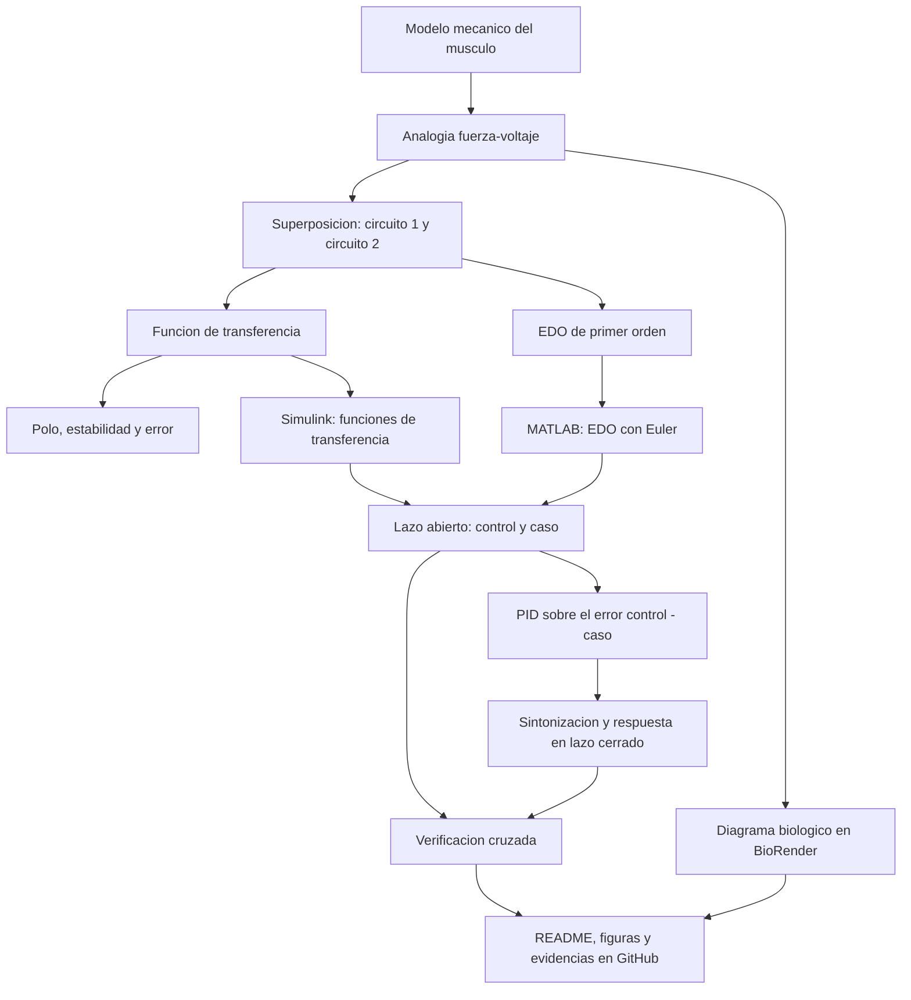

Practica 3: Modelado y control del sistema muscoesqueletico
[](https://matlab.mathworks.com/open/github/v1?repo=Nefga/MSFP3)
# Práctica Tres: Modelado y control del sistema musculoesquelético

Repositorio académico de la asignatura **Modelado de Sistemas Fisiológicos**, correspondiente al programa de **Ingeniería Biomédica** del Tecnológico Nacional de México / Instituto Tecnológico de Tijuana. Esta práctica integra modelado mecánico, analogías electromecánicas, superposición de circuitos, análisis temporal y de estabilidad, diseño de controladores PID y simulación computacional *in silico*.

El caso de estudio representa el **sistema musculoesquelético** mediante un modelo viscoelástico de primer orden (elemento contráctil, amortiguador viscoso, tendón y estructuras elásticas). Se compara la respuesta de un individuo sano (**control**) con la de un caso simulado de **atrofia muscular** (**caso**), tanto en lazo abierto como en lazo cerrado con un controlador PID que reduce la diferencia entre ambas respuestas.

**Docente:** Dr. Paul Antonio Valle Trujillo  
**Correo:** paul.valle@tectijuana.edu.mx  
**Departamento:** Ingeniería Eléctrica y Electrónica  
**Institución:** Tecnológico Nacional de México / Instituto Tecnológico de Tijuana  
**Asignatura:** Modelado de Sistemas Fisiológicos  
**Programa:** Ingeniería Biomédica  
**Estudiante:** Neltzon Farid García Altamirano · 23212194 · l23212194@tijuana.tecnm.mx

**Repositorio de la asignatura:** https://github.com/DrPaulValle/MSF-IBF1020  
**Sede:** Blvd. Alberto Limón Padilla s/n, Tijuana, C. P. 22454, B. C., México.

---

<a id="contenido"></a>
## Contenido

1. [Resumen](#resumen)
2. [Competencia y objetivos](#objetivos)
3. [Relación con el temario](#temario)
4. [Modelo físico y analogía eléctrica](#analogia)
5. [Formulación matemática](#modelo)
6. [Análisis temporal y de estabilidad](#analisis)
7. [Señales de entrada y condiciones de simulación](#senales)
8. [Implementación en MATLAB y Simulink](#matlab)
9. [Control en lazo cerrado y sintonización PID](#pid)
10. [Resultados y verificación cruzada](#resultados)
11. [Flujo de trabajo](#flujo)
12. [Actividades del estudiante](#actividades)
13. [Estructura del repositorio](#estructura)
14. [Requisitos](#requisitos)
15. [Reproducibilidad y entregables](#reproducibilidad)
16. [Referencias](#referencias)

---

<a id="resumen"></a>
## Resumen

La práctica tiene como propósito **modelar, analizar, simular y controlar** un compartimento musculoesquelético a partir de un modelo mecánico simplificado. El músculo se aproxima mediante un amortiguador viscoso $R$, un elemento elástico en serie $C_s$ (tendón), un elemento elástico en paralelo $C_p$ (estructuras pasivas del músculo) y una fuente de fuerza activa $F_0(t)=\alpha F(t)$ que representa al elemento contráctil. Mediante la analogía fuerza–voltaje se obtiene un circuito eléctrico equivalente, que se resuelve por **superposición**: primero con la fuente $F_0(t)$ apagada y después con $F(t)$ apagada. La suma de ambas contribuciones da la función de transferencia

$$
\boxed{G(s)=\frac{F_s(s)}{F(s)}=\frac{R\,C_s\,s+1-\alpha}{R\,(C_p+C_s)\,s+1}.}
$$

El **caso de atrofia** se representa únicamente incrementando $R$ de $100\,\Omega$ a $10\,\mathrm{k}\Omega$. Esto no modifica la ganancia en estado estacionario, pero vuelve la respuesta 100 veces más lenta: la constante de tiempo pasa de $11\,\mathrm{ms}$ a $1.1\,\mathrm{s}$.

Se estudian el error en estado estacionario y la estabilidad a través del polo de cada modelo. Posteriormente se aplica un pulso de entrada y se contrastan la función de transferencia implementada en Simulink y un modelo de EDO integrado en MATLAB. Se incorpora un **controlador PID** sobre el modelo del caso, cuya señal de error es la diferencia entre la respuesta del control y la del caso, y cuyas ganancias se sintonizan con la herramienta *Tune* de Simulink.

La práctica se desarrolla **exclusivamente mediante experimentación *in silico***. La estrategia de control tiene propósitos académicos y de simulación, y no constituye una estrategia terapéutica para el tratamiento de la atrofia muscular.

**Palabras clave:** sistema musculoesquelético; modelo viscoelástico; analogía fuerza–voltaje; superposición; función de transferencia; controlador PID; atrofia muscular; MATLAB; Simulink; simulación *in silico*.

[Volver al contenido](#contenido)

---

<a id="objetivos"></a>
## Competencia y objetivos

### Competencia a desarrollar

Modelizar sistemas fisiológicos mediante analogías entre sistemas físicos, ecuaciones diferenciales y funciones de transferencia para analizar su comportamiento dinámico, y diseñar estrategias de control mediante técnicas de control clásico. En particular, se analiza un modelo mecánico simplificado del sistema musculoesquelético, se construye su circuito eléctrico equivalente mediante la analogía fuerza–voltaje, se compara la respuesta de un individuo sano (control) con un caso simulado de atrofia muscular (caso) y se diseña una estrategia de control *in silico* orientada a reducir las diferencias entre ambas respuestas.

### Objetivo general

Analizar y controlar el modelo viscoelástico del sistema musculoesquelético mediante su formulación matemática, su implementación computacional y el diseño de un controlador PID, comparando las respuestas del control, del caso y del sistema controlado.

### Objetivos específicos

- Identificar los elementos del modelo mecánico $F_0(t)$, $F(t)$, $R$, $C_p$, $C_s$, $x(t)$ y $x_1(t)$, y describir su función.
- Convertir el modelo mecánico en un circuito eléctrico equivalente mediante la analogía fuerza–voltaje.
- Obtener la función de transferencia aplicando la transformada de Laplace y el principio de superposición.
- Expresar el modelo como una ecuación diferencial ordinaria de primer orden.
- Determinar el error en estado estacionario y analizar la estabilidad mediante el polo de cada modelo.
- Comparar la respuesta del control y del caso y analizar el efecto del incremento de $R$.
- Implementar un controlador PID sobre el caso, sintonizar sus ganancias con *Tune* y obtener la función de transferencia del sistema controlado.
- Reproducir las respuestas de lazo abierto y lazo cerrado mediante Simulink y MATLAB.
- Elaborar un diagrama biológico que relacione los elementos del modelo con las estructuras musculares.
- Documentar la práctica en un repositorio de GitHub.

[Volver al contenido](#contenido)

---

<a id="temario"></a>
## Relación con el temario

La práctica integra contenidos correspondientes a tres unidades de la asignatura **Modelado de Sistemas Fisiológicos (IBF-1020)**:

| Unidad | Área | Contenidos aplicados |
|---|---|---|
| I | Sistemas de control retroalimentados | Elementos del sistema de control, diagramas de bloques, respuesta ante un pulso, análisis de error y criterios de estabilidad |
| II | Modelado matemático | Analogía fuerza–voltaje, superposición, transformada de Laplace y función de transferencia de primer orden |
| III | Controladores | Controlador PID, diseño y sintonización de ganancias |

El enfoque combina **Ingeniería de Control, Electrónica Analógica, Ciencias de la Computación y Fisiología**, de acuerdo con la competencia general de la asignatura.

[Volver al contenido](#contenido)

---

<a id="analogia"></a>
## Modelo físico y analogía eléctrica

El modelo mecánico (Figura 5.3 del syllabus, adaptado de Khoo [1]) representa las propiedades viscoelásticas del músculo mediante un elemento contráctil, un amortiguador y dos resortes. La deformación del amortiguador es $x(t)-x_1(t)$, por lo que su velocidad relativa es $\frac{d}{dt}[x(t)-x_1(t)]$. La fuerza del elemento contráctil se relaciona con la fuerza del modelo mediante

$$
F_0(t)=\alpha F(t),\qquad 0<\alpha<1.
$$

### Correspondencia entre el modelo mecánico, el circuito y la fisiología

| Elemento mecánico | Equivalente eléctrico | Interpretación fisiológica |
|---|---|---|
| $F(t)$ | Voltaje de entrada | Fuerza generada |
| $F_0(t)=\alpha F(t)$ | Fuente de voltaje del elemento contráctil | Elemento contráctil muscular |
| $R$ | Resistencia | Comportamiento viscoso del tejido |
| $C_s$ | Capacitancia (elemento en serie) | Tendón |
| $C_p$ | Capacitancia (elemento en paralelo) | Sarcolema y estructuras elásticas musculares pasivas |
| $x(t)$ | Carga / corriente en la rama de $C_p$ | Desplazamiento total |
| $x_1(t)$ | Carga / corriente en la rama de $C_s$ | Deformación del tendón |
| $F_s(t)$ | Voltaje de salida | Fuerza transmitida |

### Diagrama biológico


*Figura elaborada en BioRender. A la derecha se muestra el modelo mecánico equivalente; a la izquierda se ubica cada elemento del modelo en el músculo y su tendón.*

Cada elemento del diagrama se relaciona con el modelo mecánico y con su equivalente eléctrico de la siguiente forma:

| Elemento del diagrama | Modelo mecánico | Equivalente eléctrico |
|---|---|---|
| Fuerza generada $F(t)$ | Fuerza de entrada del modelo | Fuente de voltaje $F(t)$ |
| Elemento contráctil muscular $F_0$ | Fuerza activa $F_0(t)=\alpha F(t)$ | Fuente de voltaje $\alpha F(t)$ |
| Elemento viscoso muscular $R$ | Amortiguador | Resistencia $R$ |
| Estructuras elásticas musculares $C_p$ | Resorte en paralelo | Capacitancia $C_p$ |
| Tendón $C_s$ | Resorte en serie | Capacitancia $C_s$ |
| Desplazamiento del músculo $x(t)-x_1(t)$ | Deformación del amortiguador | Carga asociada a $R$ |
| Desplazamiento del tendón $x_1(t)$ | Deformación de $C_s$ | Carga asociada a $C_s$ |
| Desplazamiento total $x(t)$ | Desplazamiento de $C_p$ | Carga asociada a $C_p$ |

El desplazamiento total se reparte entre el músculo y el tendón: $x(t)=\left[x(t)-x_1(t)\right]+x_1(t)$.

### Analogía fuerza–voltaje

| Sistema mecánico | Sistema eléctrico equivalente |
|---|---|
| Fuerza $F(t)$ | Voltaje $V(t)$ |
| Velocidad $\dot{x}(t)$ | Corriente $I(t)$ |
| Desplazamiento $x(t)$ | Carga eléctrica $q(t)$ |
| Amortiguador | Resistencia $R$ |
| Compliancia mecánica | Capacitancia $C$ |
| Masa | Inductancia $L$ (no presente en este modelo) |

Una consecuencia de esta analogía es que las conexiones mecánicas y eléctricas no conservan necesariamente la misma topología: componentes mecánicos en paralelo pueden convertirse en elementos eléctricos en serie, y componentes mecánicos en serie, en elementos eléctricos en paralelo.

> **Nota de notación:** en los cálculos por superposición de la siguiente sección, $x(t)$ designa la **corriente** (velocidad mecánica) que circula por la rama de $C_p$, de acuerdo con la relación $x(t)=C_p\,\dfrac{dF_{s1}(t)}{dt}$. Por eso aparece como corriente en las ecuaciones de malla y no como desplazamiento.

### Parámetros para la simulación

| Parámetro | Control (sano) | Caso (atrofia) | Unidad |
|---|---:|---:|---|
| $F(t)$ | $1$ | $1$ | V |
| $\alpha$ | $0.25$ | $0.25$ | — |
| $C_s$ | $10$ | $10$ | µF |
| $C_p$ | $100$ | $100$ | µF |
| $R$ | $100$ | $10\,000$ | Ω |

La **única** diferencia entre control y caso es el incremento de $R$, que modifica la componente viscosa del modelo y produce una respuesta mecánica diferente.

> **Alcance de la analogía:** los valores anteriores corresponden al circuito eléctrico equivalente empleado para la experimentación *in silico*. La correspondencia entre unidades eléctricas y mecánicas conserva la estructura matemática, pero no debe interpretarse como una conversión numérica directa de unidades sin especificar factores de escala.

[Volver al contenido](#contenido)

---

<a id="modelo"></a>
## Formulación matemática

El circuito tiene dos fuentes, $F(t)$ y $F_0(t)=\alpha F(t)$. Como el sistema es lineal, la salida se obtiene como suma de dos contribuciones:

$$
F_s(t)=F_{s1}(t)+F_{s2}(t),
$$

donde $F_{s1}$ es la respuesta con $F_0(t)$ apagada y $F_{s2}$ la respuesta con $F(t)$ apagada.

### 1. Circuito 1: apagando $F_0(t)$

La corriente total que carga a $C_p$ es la suma de la corriente de la rama de $C_s$ y la de la rama de $R$, ambas alimentadas por la diferencia $F(t)-F_{s1}(t)$:

$$
x(t)=x_1(t)+x_2(t),\qquad x(t)=C_p\frac{dF_{s1}(t)}{dt},
$$

$$
x_1(t)=C_s\frac{d\left[F(t)-F_{s1}(t)\right]}{dt},\qquad
x_2(t)=\frac{F(t)-F_{s1}(t)}{R}.
$$

Igualando:

$$
C_p\frac{dF_{s1}(t)}{dt}=C_s\frac{d\left[F(t)-F_{s1}(t)\right]}{dt}+\frac{F(t)-F_{s1}(t)}{R}.
$$

Aplicando la transformada de Laplace con condiciones iniciales nulas:

$$
C_p s F_{s1}(s)=C_s s\left[F(s)-F_{s1}(s)\right]+\frac{F(s)-F_{s1}(s)}{R}.
$$

Agrupando los términos en $F_{s1}(s)$ a la izquierda y los de $F(s)$ a la derecha:

$$
\left(C_p s+C_s s+\frac{1}{R}\right)F_{s1}(s)=\left(C_s s+\frac{1}{R}\right)F(s),
$$

$$
\frac{R(C_p+C_s)s+1}{R}\,F_{s1}(s)=\frac{C_sRs+1}{R}\,F(s).
$$

Despejando:

$$
\boxed{\frac{F_{s1}(s)}{F(s)}=\frac{R\,C_s\,s+1}{R\,(C_p+C_s)\,s+1}.}
$$

### 2. Circuito 2: apagando $F(t)$

Con $F(t)$ apagada solo actúa la fuente del elemento contráctil. Las capacitancias $C_s$ y $C_p$ quedan en paralelo (capacitancia equivalente $C_p+C_s$), en serie con $R$:

$$
-\alpha F(t)=R\,x(t)+\frac{1}{C_p+C_s}\int x(t)\,dt,\qquad
F_{s2}(t)=\frac{1}{C_p+C_s}\int x(t)\,dt.
$$

En el dominio de Laplace:

$$
-\alpha F(s)=R\,X(s)+\frac{X(s)}{(C_p+C_s)s},\qquad
F_{s2}(s)=\frac{X(s)}{(C_p+C_s)s}.
$$

De la primera ecuación, $-\alpha F(s)=X(s)\,\dfrac{R(C_p+C_s)s+1}{(C_p+C_s)s}$. Dividiendo la segunda ecuación entre la primera, $X(s)$ se cancela:

$$
\frac{F_{s2}(s)}{-\alpha F(s)}=\frac{\dfrac{X(s)}{(C_p+C_s)s}}{X(s)\,\dfrac{R(C_p+C_s)s+1}{(C_p+C_s)s}}=\frac{1}{R(C_p+C_s)s+1},
$$

$$
\boxed{\frac{F_{s2}(s)}{F(s)}=\frac{-\alpha}{R\,(C_p+C_s)\,s+1}.}
$$

### 3. Función de transferencia

Por superposición, $F_s(s)=F_{s1}(s)+F_{s2}(s)$:

$$
F_s(s)=\frac{(C_sRs+1)\,F(s)}{R(C_p+C_s)s+1}-\frac{\alpha\,F(s)}{R(C_p+C_s)s+1},
$$

$$
\boxed{G(s)=\frac{F_s(s)}{F(s)}=\frac{R\,C_s\,s+1-\alpha}{R\,(C_p+C_s)\,s+1}.}
$$

El denominador es de primer grado debido a que el modelo tiene **un único modo dinámico independiente**, asociado con la constante de tiempo $\tau=R(C_p+C_s)$.

Sustituyendo $\alpha=0.25$, $C_s=10\,\mu\mathrm{F}$ y $C_p=100\,\mu\mathrm{F}$, las funciones de transferencia completas de cada condición son:

$$
G_{control}(s)=\frac{100\,(10\times10^{-6})\,s+1-0.25}{100\,(110\times10^{-6})\,s+1}=\frac{0.001\,s+0.75}{0.011\,s+1},
$$

$$
G_{caso}(s)=\frac{10^{4}\,(10\times10^{-6})\,s+1-0.25}{10^{4}\,(110\times10^{-6})\,s+1}=\frac{0.1\,s+0.75}{1.1\,s+1}.
$$

### 4. Representación mediante EDO de primer orden

Separando $G(s)$ en una ganancia directa más un filtro de primer orden:

$$
G(s)=\frac{C_s}{C_p+C_s}+\frac{1-\alpha-\dfrac{C_s}{C_p+C_s}}{R(C_p+C_s)s+1}.
$$

Definiendo la variable auxiliar $x(t)$ como la salida del filtro de primer orden con entrada $F(t)$, es decir $X(s)=F(s)/[R(C_p+C_s)s+1]$, el modelo se expresa como

$$
\begin{aligned}
\dot{x}(t)&=\frac{F(t)-x(t)}{R\,(C_p+C_s)},\\[4pt]
F_s(t)&=\frac{C_s}{C_p+C_s}\,F(t)+\left(1-\alpha-\frac{C_s}{C_p+C_s}\right)x(t).
\end{aligned}
$$

Esta es la forma que se integra por el método de Euler en la función `musculoesqueletico` de la sección [Implementación](#matlab). La variable auxiliar $x(t)$ de este modelo de estado **no** es la $x(t)$ de los cálculos por superposición.

[Volver al contenido](#contenido)

---

<a id="analisis"></a>
## Análisis temporal y de estabilidad

### 1. Control y caso

| Característica | Control ($R=100\,\Omega$) | Caso ($R=10\,\mathrm{k}\Omega$) |
|---|---:|---:|
| $G(s)$ | $\dfrac{0.001\,s+0.75}{0.011\,s+1}$ | $\dfrac{0.1\,s+0.75}{1.1\,s+1}$ |
| Constante de tiempo $\tau=R(C_p+C_s)$ | $11\ \mathrm{ms}$ | $1.1\ \mathrm{s}$ |
| Polo | $-90.91\ \mathrm{s^{-1}}$ | $-0.909\ \mathrm{s^{-1}}$ |
| Cero | $-750\ \mathrm{s^{-1}}$ | $-7.5\ \mathrm{s^{-1}}$ |
| Ganancia en estado estacionario $G(0)=1-\alpha$ | $0.75$ | $0.75$ |
| Salto inicial $G(\infty)=\dfrac{C_s}{C_p+C_s}$ | $0.0909$ | $0.0909$ |
| Tiempo de establecimiento ($\approx 4\tau$) | $\approx 44\ \mathrm{ms}$ | $\approx 4.4\ \mathrm{s}$ |

### 2. Error en estado estacionario

Para una entrada escalón unitario,

$$
F(s)=\frac{1}{s},\qquad F_s(s)=G(s)\frac{1}{s}.
$$

Si se cumple la estabilidad requerida para aplicar el teorema del valor final,

$$
\lim_{t\to\infty}F_s(t)=\lim_{s\to0}sF_s(s)=G(0)=1-\alpha=0.75\,\mathrm{V}.
$$

Así, el error entre la entrada y la salida para **esa entrada escalón en lazo abierto** es

$$
\boxed{e_{ss}=\lim_{s\to0}sF(s)[1-G(s)]=\alpha=0.25.}
$$

$G(0)$ no depende de $R$: **el incremento de $R$ no modifica el valor final**, solo la rapidez con la que se alcanza. Control y caso tienen el mismo error en estado estacionario.

### 3. Polo y estabilidad

El polo del sistema satisface

$$
R(C_p+C_s)s+1=0,
$$

$$
\boxed{p=-\frac{1}{R\,(C_p+C_s)}.}
$$

Como $R$, $C_p$ y $C_s$ son positivos, el denominador tiene coeficientes positivos y el polo es real y negativo. Ambos modelos son **estables**. Al aumentar $R$, el polo se desplaza hacia el origen (de $-90.9$ a $-0.909$): la respuesta se vuelve más lenta, no inestable.

### 4. Predicción previa

Con los resultados anteriores se espera, ante un pulso de $1\,\mathrm{V}$ y $1\,\mathrm{s}$:

- un **salto inmediato** de $\approx 0.09\,\mathrm{V}$ al subir la entrada, porque el numerador y el denominador de $G(s)$ son del mismo grado;
- un crecimiento exponencial hacia $0.75\,\mathrm{V}$ con constante de tiempo $\tau$: el control alcanza esa meseta en unos $44\,\mathrm{ms}$, y el caso no la alcanza durante el pulso de $1\,\mathrm{s}$;
- una caída inmediata de $\approx 0.09\,\mathrm{V}$ al bajar la entrada, seguida de un decaimiento exponencial a cero con la misma $\tau$.

#### Ejemplo mínimo de verificación en MATLAB

```matlab
alpha = 0.25;
Cs = 10e-6;
Cp = 100e-6;

R = 100;
Gcontrol = tf([R*Cs, 1-alpha], [R*(Cp+Cs), 1]);
polo_control = pole(Gcontrol)

R = 10e3;
Gcaso = tf([R*Cs, 1-alpha], [R*(Cp+Cs), 1]);
polo_caso = pole(Gcaso)
```

[Volver al contenido](#contenido)

---

<a id="senales"></a>
## Señales de entrada y condiciones de simulación

El intervalo de simulación es $0\le t\le10\,\mathrm{s}$. Se establece un **paso máximo** de $\Delta t=10^{-3}\,\mathrm{s}$ y el solver `ode15s` en Simulink.

| Señal | Definición para la simulación | Propósito |
|---|---|---|
| Pulso | Amplitud $1\,\mathrm{V}$, duración $1\,\mathrm{s}$, inicio en $t=1\,\mathrm{s}$ (periodo $10\,\mathrm{s}$, ancho $10\,\%$, retardo $1\,\mathrm{s}$) | Examinar la respuesta ante una perturbación de duración finita |

La misma señal se aplica al control, al caso y al caso con controlador, con condiciones iniciales nulas, para que las respuestas sean comparables.

[Volver al contenido](#contenido)

---

<a id="matlab"></a>
## Implementación en MATLAB y Simulink

El modelo de Simulink (`MPSFP3NFGA.slx`) contiene los siguientes elementos:

| Elemento | Bloque | Descripción |
|---|---|---|
| Entrada | `Discrete Pulse Generator` | Pulso de $1\,\mathrm{V}$: periodo $10\,\mathrm{s}$, ancho $10\,\%$, retardo $1\,\mathrm{s}$ |
| Control | Subsistema `Control` | Función de transferencia $G_{control}(s)$ con $R=100\,\Omega$ |
| Caso en lazo abierto | Función de transferencia en `Sistema:Normotenso1` | Función de transferencia $G_{caso}(s)$ con $R=10\,\mathrm{k}\Omega$ |
| Caso en lazo cerrado | Función de transferencia $G_{caso}(s)$, `PID Controller` y `Sum` | El `Sum` calcula $e(t)=x_{control}(t)-x_{caso}(t)$, el PID genera la señal de control y la planta del caso produce la salida |
| Registro de señales | `To Workspace` | Variables `F` (entrada), `Fsx` (control), `FsY` (caso en lazo abierto) y `PID` (caso con controlador) |

El numerador y el denominador de cada función de transferencia se escriben con los parámetros del circuito, `[R*Cs, 1-alpha]` y `[R*(Cp+Cs), 1]`.

### Ejecución desde el cuaderno MATLAB

El cuaderno (`.mlx`) ejecuta el modelo de Simulink, recupera las señales en el *Workspace* y las grafica con la función `plotsignals`.

#### Datos de la simulación

```matlab
clc; clear; close all; warning('off','all')
open_system('MPSFP3NFGA.slx')
parameters.StopTime = '10';
parameters.Solver = 'ode15s';
parameters.MaxStep ='1e-3';
```

#### Respuesta del modelo de Simulink

```matlab
X = sim('MPSFP3NFGA.slx',parameters);
plotsignals(X.t,X.F,X.Fsx,X.FsY,X.PID, 'Simulink')
```

#### Modelo de EDO

Se integra el modelo de la [sección 4 de la formulación matemática](#modelo) con el método de Euler y paso $\Delta t=10^{-3}\,\mathrm{s}$, para el control y para el caso, y se compara con la respuesta de Simulink. El vector `par` tiene el orden `[alpha, Cs, Cp, R]`.

```matlab
dt = 1e-3;
t = (0:dt:10)';
F = zeros(length(t),1); F(1/dt:2/dt) = 1;
PID = interp1(X.t, X.PID, t, 'previous');

par_control = [0.25,10e-6,100e-6,100];
par_caso = [0.25,10e-6,100e-6,10e3];

Fs_control = musculoesqueletico(par_control,F,t);
Fs_caso =  musculoesqueletico(par_caso,F,t);

plotsignals(t,F,Fs_control,Fs_caso,PID,'EDOsys')
```

```matlab
function Fs = musculoesqueletico(par,F,t)
    alpha = par(1); Cs = par(2); Cp = par(3); R = par (4); dt =  t(2);
n = round(t(end)/dt);
    x = zeros(length(t),1); x(1) = 0;
    Fs = zeros(length(t),1); Fs(1) = 0;
for i = 1:n
        x(i+1) = x(i) + ((F(i)-x(i))/(R*(Cp+Cs)))*dt;
        Fs(i+1) = Cs*F(i)/(Cp+Cs) + (1-alpha-Cs/(Cp+Cs))*x(i);
end
end
```

Las dos líneas dentro del ciclo `for` son la discretización de Euler de las ecuaciones de estado:

| Línea del código | Ecuación |
|---|---|
| `x(i+1) = x(i) + ((F(i)-x(i))/(R*(Cp+Cs)))*dt` | $\dot{x}=\dfrac{F-x}{R(C_p+C_s)}$ |
| `Fs(i+1) = Cs*F(i)/(Cp+Cs) + (1-alpha-Cs/(Cp+Cs))*x(i)` | $F_s=\dfrac{C_s}{C_p+C_s}F+\left(1-\alpha-\dfrac{C_s}{C_p+C_s}\right)x$ |

#### Función de graficación

```matlab
function plotsignals(t,F,Fsx,FsY,PID,name)
set(figure(),'color','w')
set(gcf,'units','inches','position',[1,1,7,3.5])
set(gca,'fontname','times new roman','fontsize',11)
hold on; grid off; box on;
ctrl1 = [0, 125, 204]/255;
ctrl2 = [235,185,0]/255;
ctrl3 = [209,0,86]/255;
ctrl4 = [80,0,113]/255;
order = [ctrl1;ctrl2;ctrl3;ctrl4]; colororder(order)

plot(t,F,'-','Linewidth',1.5,'Color',ctrl1)
plot(t,Fsx,'-','Linewidth',1.5,'Color',ctrl2)
plot(t,FsY,'-','Linewidth',1.5,'Color',ctrl3)
plot(t,PID,':','Linewidth',2.5,'Color',ctrl4)
L = legend('$F(t)$','$F_{s}(t):Control$','$F_{s}(t):Caso$','$PID: Transferencia');
set(L,'interpreter','latex','FontSize',9,'location','northoutside','orientation','horizontal','Box','Off')
xlabel('$t$ [s]','interpreter','latex')
ylabel('$F_i (t)$ [V]','interpreter','latex')
xlim([-0.25 10]); xticks(0:1:10)
ylim([-0.1,1.2]); yticks(-0.1:0.1:1.2)


exportgraphics(gcf,[name,'_matlab','.pdf'],'ContentType','vector')


end
```

La función grafica la entrada, el control, el caso y la respuesta con PID, identifica las variables y sus unidades, y guarda la figura en PDF vectorial (`Simulink_matlab.pdf` y `EDOsys_matlab.pdf`).

[Volver al contenido](#contenido)

---

<a id="pid"></a>
## Control en lazo cerrado y sintonización PID

### 1. Retroalimentación negativa

La respuesta del individuo sano se utiliza como **referencia** para el caso. Siguiendo el esquema de la Figura 5.4 del syllabus (individuo sano → comparación → PID → paciente), el controlador PID se incorpora al modelo del caso y actúa sobre la señal de error

$$
e(t)=x_{control}(t)-x_{caso}(t).
$$

La ley de control ideal en el dominio temporal está dada por

$$
u(t)=k_Pe(t)+k_I\int_0^t e(\tau)\,d\tau+k_D\frac{de(t)}{dt},
$$

y en el dominio de Laplace, formalmente,

$$
K(s)=k_P+\frac{k_I}{s}+k_Ds.
$$

Con retroalimentación negativa unitaria y tomando como referencia la salida del control, la respuesta del caso con controlador es

$$
F_{s,caso}^{PID}(s)=\frac{K(s)G_{caso}(s)}{1+K(s)G_{caso}(s)}\,F_{s,control}(s)=T(s)\,F_{s,control}(s).
$$

### 2. Sintonización

Se utiliza la opción **Tune** del bloque `PID Controller` de Simulink (forma paralela, tiempo continuo), buscando una respuesta estable y una reducción del error entre la salida del caso y la respuesta de referencia del individuo sano. Las ganancias obtenidas son:

| Ganancia | Valor |
|---|---:|
| $k_P$ | $0.021475$ |
| $k_I$ | $42\,258.77$ |
| $k_D$ | $0$ |
| $N$ (filtro derivativo) | $100$ |

Con $k_D=0$ el controlador es un **PI**, y el filtro derivativo $N$ no interviene:

$$
K(s)=0.021475+\frac{42\,258.77}{s}=\frac{0.021475\,s+42\,258.77}{s}.
$$

### 3. Función de transferencia del sistema controlado

Sustituyendo $K(s)$ y $G_{caso}(s)$ en $T(s)$:

$$
T(s)=\frac{K(s)G_{caso}(s)}{1+K(s)G_{caso}(s)}
=\frac{(0.021475\,s+42\,258.77)(0.1\,s+0.75)}{s\,(1.1\,s+1)+(0.021475\,s+42\,258.77)(0.1\,s+0.75)}.
$$

Desarrollando los productos:

$$
T(s)=\frac{0.0021475\,s^{2}+4225.893\,s+31\,694.08}{1.1021475\,s^{2}+4226.893\,s+31\,694.08}
=\frac{0.0019484\,s^{2}+3834.236\,s+28\,756.66}{s^{2}+3835.143\,s+28\,756.66}.
$$

La función de transferencia completa del sistema controlado, desde la fuerza de entrada $F(s)$ hasta la salida del caso con PID, incluye además la planta del control que genera la referencia:

$$
\boxed{\frac{F_{s,caso}^{PID}(s)}{F(s)}=T(s)\,G_{control}(s)=\frac{0.0019484\,s^{2}+3834.236\,s+28\,756.66}{s^{2}+3835.143\,s+28\,756.66}\cdot\frac{0.001\,s+0.75}{0.011\,s+1}.}
$$

Propiedades de $T(s)$:

| Característica | Valor |
|---|---|
| Polos | $-3827.63$ y $-7.513$ |
| Ceros | $-7.5$ y $-1.97\times10^{6}$ |
| Ganancia en estado estacionario $T(0)$ | $1$ |

- $T(0)=1$: gracias a la acción integral, el caso alcanza sin error el valor de la referencia ante una entrada constante.
- El polo lento de $T(s)$ ($-7.513$) coincide casi con el cero del caso ($-7.5$), por lo que prácticamente se cancelan. La dinámica dominante pasa a ser la del polo rápido ($-3827.63$), con constante de tiempo de $\approx0.26\,\mathrm{ms}$, en lugar de los $1.1\,\mathrm{s}$ del caso en lazo abierto.
- Los dos polos son reales y negativos, por lo que el sistema controlado es estable.

[Volver al contenido](#contenido)

---

<a id="resultados"></a>
## Resultados y verificación cruzada

Las respuestas permiten contrastar **entrada, control, caso en lazo abierto y caso con controlador**. La convención gráfica de `plotsignals` es:

- **Azul:** entrada aplicada, $F(t)$.
- **Amarillo:** respuesta del control (individuo sano), $F_s(t)$.
- **Rojo/magenta:** respuesta del caso (atrofia) en lazo abierto, $F_s(t)$.
- **Morado punteado:** respuesta del caso con PID.

### Respuesta en lazo abierto ante el pulso de 1 V y 1 s

Valores obtenidos de las funciones de transferencia con el pulso unitario que inicia en $t=1\,\mathrm{s}$:

| Instante | Control ($\tau=11\,\mathrm{ms}$) | Caso ($\tau=1.1\,\mathrm{s}$) |
|---|---:|---:|
| Salto inicial al subir el pulso | $\approx 0.09\ \mathrm{V}$ | $\approx 0.09\ \mathrm{V}$ |
| Valor al final del pulso ($t=2\,\mathrm{s}$) | $\approx 0.75\ \mathrm{V}$ (meseta alcanzada) | $\approx 0.48\ \mathrm{V}$ (sin alcanzar la meseta) |
| Valor inmediatamente después de bajar el pulso | $\approx 0.66\ \mathrm{V}$ | $\approx 0.39\ \mathrm{V}$ |
| Regreso a cero | $\approx 44\ \mathrm{ms}$ | $\approx 4.4\ \mathrm{s}$ |

### Efecto del controlador

Diferencia entre la respuesta de referencia (control) y la del caso, sin y con PID:

| Métrica | Caso en lazo abierto | Caso con PID |
|---|---:|---:|
| Error máximo $\lvert x_{control}-x_{caso}\rvert$ | $0.62\ \mathrm{V}$ | $0.089\ \mathrm{V}$ (en el flanco de bajada, $t=2\,\mathrm{s}$) |
| Error máximo durante la meseta del pulso ($1.1<t<2\,\mathrm{s}$) | $\approx 0.60\ \mathrm{V}$ | $0.0007\ \mathrm{V}$ |
| Error máximo para $t>2.5\,\mathrm{s}$ | $\approx 0.25\ \mathrm{V}$ | $3\times10^{-5}\ \mathrm{V}$ |
| Integral del error cuadrático $\int e^2\,dt$ | $0.275$ | $5.2\times10^{-6}$ |

Con el PID, la salida del caso sigue prácticamente la misma curva que el control. El único error apreciable aparece en el instante en que la referencia cae de forma instantánea ($t=2\,\mathrm{s}$), que el controlador corrige en unos milisegundos.

### Archivos de resultados

| Representación | Archivo |
|---|---|
| Modelo de Simulink (control, caso y PID) | [`Simulink_matlab.pdf`](Simulink_matlab.pdf) |
| Modelo de EDO (control, caso y PID de Simulink) | [`EDOsys_matlab.pdf`](EDOsys_matlab.pdf) |

Los PDF se enlazan para su consulta, dado que GitHub no los presenta como imágenes incrustadas convencionales.

### Discusión

- **Efecto de $R$.** El caso de atrofia se modela solo aumentando $R$: el polo pasa de $-90.9$ a $-0.909$ y se conserva $G(0)=0.75$. El caso llega al mismo valor final que el control, pero 100 veces más lento. Ante un pulso de $1\,\mathrm{s}$, el control alcanza su meseta y el caso no.
- **Consistencia entre representaciones.** La función de transferencia de Simulink y la integración por Euler describen la misma dinámica de primer orden. Con $\Delta t=1\,\mathrm{ms}$ el método de Euler es estable en ambos casos (el más exigente es el control, con $\Delta t/\tau\approx0.09$).
- **Salto instantáneo.** Como el numerador y el denominador de $G(s)$ son del mismo grado, la salida salta de forma inmediata a $C_s/(C_p+C_s)\approx0.09$ al subir o bajar la entrada.
- **Controlador.** El PID sintonizado, que con $k_D=0$ es un PI, cancela casi por completo la lentitud del caso: el error cuadrático acumulado se reduce en cinco órdenes de magnitud y la salida del caso reproduce la del individuo sano.
- **Alcance.** El controlador se diseñó con fines académicos y de simulación; no constituye una estrategia terapéutica para la atrofia muscular.

[Volver al contenido](#contenido)

---

<a id="flujo"></a>
## Flujo de trabajo



El procedimiento integra la formulación analítica y la experimentación *in silico* con una verificación cruzada entre Simulink y MATLAB.

[Volver al contenido](#contenido)

---

<a id="actividades"></a>
## Actividades del estudiante

La práctica sigue una secuencia de **modelado, simulación, control y documentación**, desarrollada exclusivamente *in silico*.

### Etapa 1. Formulación y análisis

- [x] Identificar los elementos $F_0(t)$, $F(t)$, $R$, $C_p$, $C_s$, $x(t)$ y $x_1(t)$.
- [x] Construir la analogía electromecánica fuerza–voltaje.
- [x] Formular las ecuaciones del sistema por superposición (circuitos 1 y 2).
- [x] Obtener la función de transferencia $F_s(s)/F(s)$ del control y del caso.
- [x] Expresar el modelo como EDO de primer orden.
- [x] Calcular el error en estado estacionario.
- [x] Calcular los polos y analizar la estabilidad.

### Etapa 2. Simulación del sistema

- [x] Implementar las funciones de transferencia del control y del caso en Simulink.
- [x] Implementar el modelo de EDO en MATLAB.
- [x] Obtener la respuesta en lazo abierto del control y del caso.

### Etapa 3. Diseño y comprobación del controlador

- [x] Construir el sistema de retroalimentación con PID sobre el caso.
- [x] Sintonizar y registrar $k_P$, $k_I$ y $k_D$.
- [x] Obtener la función de transferencia del sistema controlado.
- [x] Analizar la respuesta en lazo cerrado.
- [x] Desarrollar el cuaderno de MATLAB y la función de graficación con exportación a PDF.

### Etapa 4. Diagrama biológico y documentación

- [x] Elaborar el diagrama biológico en BioRender.
- [x] Relacionar cada elemento del diagrama con el modelo mecánico y su equivalente eléctrico.
- [x] Documentar la práctica en este README.

[Volver al contenido](#contenido)

---

<a id="estructura"></a>
## Estructura del repositorio

```text
.
├── README.md                  # Reporte de la práctica
├── MPSFP3NFGA.slx             # Modelo Simulink
├── Simulink_matlab.pdf        # Figura del modelo de Simulink
├── EDOsys_matlab.pdf          # Figura del modelo de EDO
└── diagrama_biologico.png     # Diagrama biológico (BioRender)
```

El cuaderno de MATLAB (`.mlx`) y su exportación en PDF se almacenan en la raíz del repositorio junto con los archivos anteriores.

[Volver al contenido](#contenido)

---

<a id="requisitos"></a>
## Requisitos

- **MATLAB** y **Simulink**, con el modelo `MPSFP3NFGA.slx` y el cuaderno de la práctica.
- Herramientas de Simulink para la sintonización del bloque **PID Controller**.
- **Control System Toolbox**, para el ejemplo de verificación que utiliza `tf` y `pole`.

[Volver al contenido](#contenido)

---

<a id="reproducibilidad"></a>
## Reproducibilidad y entregables

### Secuencia de reproducción

1. Consultar el [repositorio general de la asignatura](https://github.com/DrPaulValle/MSF-IBF1020) y descargar los archivos proporcionados para la práctica.
2. Verificar los valores de $\alpha$, $R$, $C_s$, $C_p$ y las condiciones iniciales.
3. Abrir `MPSFP3NFGA.slx` y comprobar los parámetros de las funciones de transferencia, del pulso y del bloque `PID Controller`.
4. Ejecutar el cuaderno de MATLAB para simular el modelo, generar el modelo de EDO y exportar las figuras en PDF.
5. Comparar las respuestas del control, del caso y del caso con PID en las dos figuras.

### Entregables

| Entregable | Evidencia |
|---|---|
| Análisis del modelo mecánico | Elementos del modelo y su función |
| Analogía electromecánica | Correspondencias mecánico–eléctrico y diagrama biológico |
| Análisis matemático | Superposición, función de transferencia, EDO, polo y error |
| Simulación | Modelo `MPSFP3NFGA.slx` y respuestas en lazo abierto y cerrado |
| Sintonización | Ganancias $k_P$, $k_I$, $k_D$ y función de transferencia del sistema controlado |
| MATLAB | Cuaderno `.mlx` y figuras `Simulink_matlab.pdf` y `EDOsys_matlab.pdf` |
| Diagrama biológico | `diagrama_biologico.png` |
| Documentación | `README.md` |

[Volver al contenido](#contenido)

---

<a id="referencias"></a>
## Referencias

[1] M. C. Khoo, *Physiological Control Systems: Analysis, Simulation, and Estimation*, 2nd ed., IEEE Press, 2018.

[2] F. C. Hoppensteadt y C. S. Peskin, *Modeling and Simulation in Medicine and the Life Sciences*, Springer.

[3] J. E. Hall, *Guyton and Hall Textbook of Medical Physiology*, 14th ed., Elsevier, 2021.

[4] K. Ogata, *Ingeniería de Control Moderna*, 5.ª ed., Pearson Educación, 2010.

[5] N. S. Nise, *Control Systems Engineering*, 8th ed., John Wiley & Sons, 2020.

[6] P. A. Valle, *Syllabus para Modelado de Sistemas Fisiológicos*, Tecnológico Nacional de México / Instituto Tecnológico de Tijuana, Tijuana, B. C., México, 2026. Disponible en: https://biomath.xyz/course/

[7] Tecnológico Nacional de México, *Programa de estudio de la asignatura Modelado de Sistemas Fisiológicos, IBF-1020*.

---

## Uso académico

Este repositorio se utiliza como evidencia de la práctica **Modelado y control del sistema musculoesquelético** de la asignatura Modelado de Sistemas Fisiológicos. El procedimiento se fundamenta en los materiales proporcionados por la asignatura. Su finalidad es desarrollar habilidades de modelado, simulación, control y documentación técnica; la estrategia de control tiene propósitos exclusivamente académicos y de simulación.
